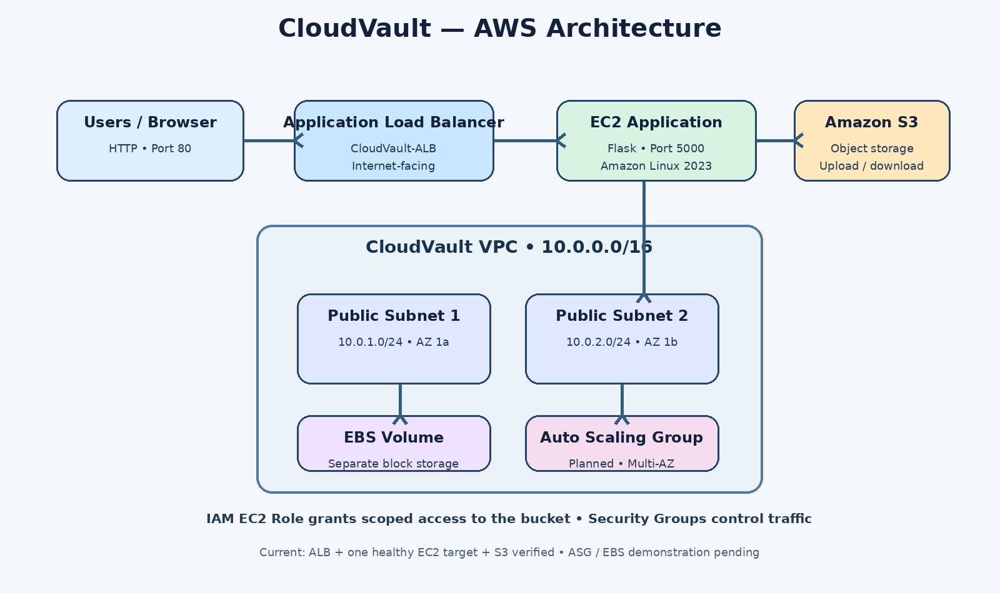
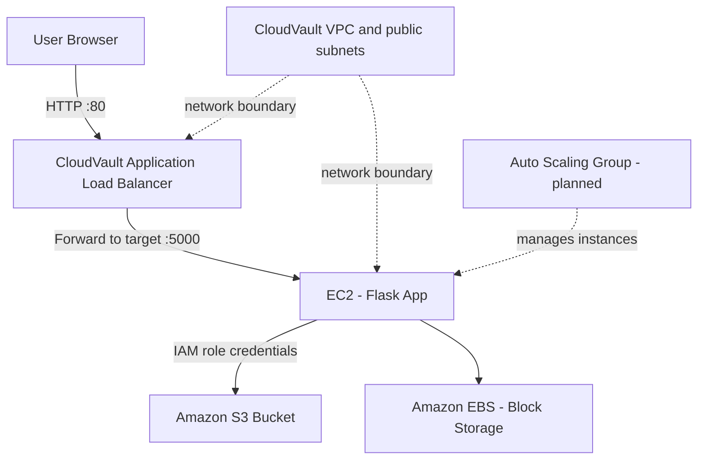
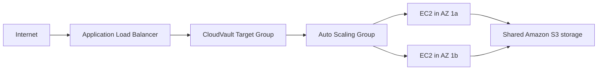

# ☁️ CloudVault — Secure Cloud-Based File Storage & Management on AWS


**CloudVault** is a cloud-hosted file-management web application built with Flask and AWS. Users can upload, browse, download and delete files through a web interface, while files are stored as objects in Amazon S3. The application is hosted on EC2 and exposed to the internet through an Application Load Balancer.

> **Live demo:** [http://cloudvault-alb-429683980.ap-south-1.elb.amazonaws.com](http://cloudvault-alb-429683980.ap-south-1.elb.amazonaws.com)  
> Region: **Asia Pacific (Mumbai) — `ap-south-1`**

---

## 📸 Application

Open the live demo above to access the CloudVault web application. The interface provides a file upload area and a file list with download and delete actions. The live application has been tested with a successful upload to S3.

## 🏗️ Architecture Overview



### Architecture components

| AWS component | Role in CloudVault |
|---|---|
| **Amazon VPC** | Isolated network environment (`10.0.0.0/16`) for the application's infrastructure. |
| **Public Subnets** | Subnets in two Availability Zones used for internet-facing infrastructure and application instances. |
| **Internet Gateway** | Provides internet connectivity for resources using the public routing configuration. |
| **Application Load Balancer (ALB)** | Accepts HTTP requests on port 80 and forwards them to registered targets. |
| **Amazon EC2** | Runs the Flask application on Amazon Linux 2023. |
| **Amazon S3** | Durable object storage for uploaded user files. |
| **AWS IAM Role** | Allows EC2 to access S3 through role credentials instead of embedded access keys. |
| **Amazon EBS** | Block storage planned/used as a separate storage demonstration for the EC2 environment. |
| **Auto Scaling** | Planned scaling layer to manage EC2 capacity and replace instances when required. |

### Network plan

- **VPC:** `CloudVault-VPC` — `10.0.0.0/16`
- **Public Subnet 1:** `10.0.1.0/24` — Availability Zone `ap-south-1a`
- **Public Subnet 2:** `10.0.2.0/24` — Availability Zone `ap-south-1b`
- **Region:** `ap-south-1`
- **ALB listener:** HTTP port `80`
- **Application target:** HTTP port `5000`
- **Health-check endpoint:** `/health`

## 🔄 Request and storage flow



### Upload flow

1. The user selects a permitted file in the CloudVault browser interface.
2. Flask validates the filename and allowed extension and creates a unique object key.
3. The application uses its EC2 IAM role to call Amazon S3.
4. S3 stores the object in the configured bucket.
5. CloudVault refreshes the file list and displays the stored file.

### Download flow

1. The user clicks **Download**.
2. The Flask app requests a time-limited presigned S3 URL.
3. The browser is redirected to that URL to download the object.

### Delete flow

1. The user submits the delete action.
2. Flask calls S3 `DeleteObject` for the selected object key.
3. The application returns to the file list with a status message.

## 🔐 Security design

- **IAM role-based access:** EC2 uses `CloudVaultEC2Role`; no static AWS access keys are intended in the application.
- **Bucket-scoped policy:** the application role is intended to be limited to the CloudVault bucket and its objects.
- **Security groups:** the load balancer is intended to accept public HTTP traffic; application traffic on port 5000 is permitted from the ALB security group.
- **Network isolation:** application resources are organized inside the project's VPC and subnets.
- **File validation:** the application restricts extensions and limits uploads to 25 MB.
- **Presigned downloads:** download URLs expire after five minutes.

> This is an educational capstone. Before production use, add authentication, authorization per user, CSRF protection, HTTPS/TLS, stronger file-content validation, logging/monitoring, and review all security rules. The current demo uses HTTP.

## 🧰 Technology stack

- **Frontend:** HTML, CSS, Flask templates
- **Backend:** Python, Flask
- **AWS SDK:** Boto3
- **Compute:** Amazon EC2 (Amazon Linux 2023)
- **Storage:** Amazon S3
- **Networking:** VPC, subnets, Internet Gateway, security groups
- **Traffic distribution:** Application Load Balancer
- **Infrastructure and access:** IAM, EBS, planned Auto Scaling

## 📂 Project structure

```text
CloudVault-AWS-Capstone/
├── app.py                 # Flask routes and web application
├── storage.py             # Local/S3 storage abstraction
├── requirements.txt        # Python dependencies
├── templates/
│   └── index.html         # CloudVault dashboard template
├── static/
│   └── style.css          # Styles
├── README.md
└── .env.example           # Example configuration (if included)
```

## ⚙️ Configuration

CloudVault reads configuration from environment variables:

| Variable | Purpose | Example |
|---|---|---|
| `AWS_BUCKET_NAME` | S3 bucket used by CloudVault | `cloudvault-storage-2026-nathanael-india` |
| `AWS_REGION` | AWS Region | `ap-south-1` |
| `FLASK_SECRET_KEY` | Flask session/flash secret | Set a unique secret value |
| `PORT` | Application port | `5000` |

The EC2 instance uses its attached IAM role to authenticate with AWS. Do not commit secrets or AWS credentials to source control.

## 🧪 Health check

The application exposes:

```text
/health
```

Expected response:

```json
{"status":"ok","storage":"s3"}
```

The target group uses this endpoint to check application health.

## 🚀 Deployment plan

### Completed and verified

- [x] Flask application deployed on Amazon EC2
- [x] Application runs on port 5000
- [x] Amazon S3 bucket configured in Mumbai (`ap-south-1`)
- [x] EC2 IAM role configured for S3 access
- [x] Application Load Balancer created
- [x] ALB listener HTTP port 80 forwarding to `CloudVault-TG`
- [x] Target group configured on port 5000
- [x] Target group health check verified — one healthy target
- [x] Browser access through the ALB DNS address
- [x] File upload tested successfully and displayed in the dashboard

### Planned / remaining capstone work

- [ ] Configure and demonstrate Auto Scaling using a Launch Template
- [ ] Demonstrate scaling/replacement across the two Availability Zones
- [ ] Complete the separate EBS volume mounting and demonstrate block storage
- [ ] Capture final screenshots and cost/cleanup documentation

## 🗺️ Planned scaling architecture

Once the Auto Scaling Group is configured, the target architecture is:



S3 is the shared file store, so replacement or additional EC2 instances can serve the same stored objects without depending on instance-local files.

## 💰 Cost and cleanup considerations

AWS resources can incur charges, even when idle. Monitor AWS Billing and Cost Management. For a student demo, consider stopping or deleting resources after use, while retaining only resources needed for the next demonstration. Load balancers, EC2 instances, EBS volumes and S3 storage may incur costs. Check the account's current pricing and Free Tier eligibility rather than assuming every resource is free.

## 📚 Learning objectives

This capstone demonstrates:

- Cloud application deployment and hosting
- Object storage with Amazon S3
- Role-based permissions with IAM
- Network design with VPCs, subnets and routing
- Traffic distribution and health checks with an ALB
- Block storage concepts with EBS
- Horizontal scaling concepts with Auto Scaling
- Integration of a Python web application with AWS services

## 👨‍💻 Project

**CloudVault — Secure Cloud-Based File Storage and Management System Using AWS**

Student cloud project / capstone demonstration.

---

*Status is documented based on the deployment state verified during the project. Auto Scaling and the EBS demonstration are marked as planned/remaining until completed and tested.*
